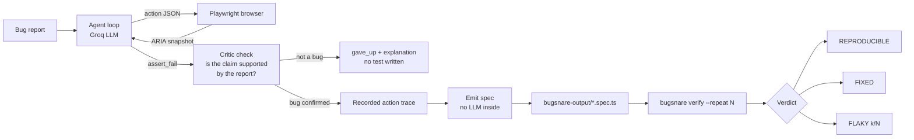

# Bugsnare 🪤

**Turn a vague bug report into a failing test, then check whether the fix worked.**

Bugsnare is an open-source agent that reads a bug report, reproduces the bug in a real browser, and writes a standalone Playwright test that fails until the bug is fixed. A second check (a "critic") makes sure the report actually supports the bug it claims. Later, `bugsnare verify` replays the generated test against a new build and tells you whether the bug is fixed, still reproducible, or flaky.

> Built solo for the Open Fire hackathon by Alan AI.

<!-- TODO: add demo GIF here -->
**Demo video:** <!-- TODO: add link -->

## Why

Bug reports like *"checkout seems broken"* make maintainers and QA engineers guess what the reporter meant. A failing test is a much cleaner contract: it either fails or it doesn't. Bugsnare automates the step between the report and that test, and the step after it (checking the fix).

## Code Map



1. **Observe.** The agent reads the page as a text ARIA snapshot (roles and names), not screenshots. It is faster, cheaper, and works with a text-only model.
2. **Decide and act.** Each step, the model returns one JSON action (`goto`, `click`, `fill`, `press`, `assert_fail`, `give_up`), validated with zod.
3. **Critic.** When the agent claims a bug, one extra model call checks whether the observed behavior really contradicts what the *report* says is correct. If not, the run ends as `gave_up` with an explanation and no test is written. If the critic call fails, Bugsnare keeps the agent's result and prints `critic unavailable`.
4. **Record and emit.** Every executed action is recorded, then replayed as a deterministic Playwright test. **The generated test contains no LLM code**, so maintainers can review it, keep it, and run it in CI.
5. **Replay check.** After emitting a spec, Bugsnare replays it 3 times and reports whether the repro is stable.
6. **Verify.** `bugsnare verify` runs the spec N times against any target and classifies the result.

If the agent cannot observe the bug, it says so (`gave_up`) and lists what it tried, instead of claiming a bug it did not see.

## Quickstart

```bash
git clone https://github.com/greeshma-ch/bugsnare.git
cd bugsnare
npm install
npx playwright install chromium
cp .env.example .env        # then set GROQ_API_KEY and GROQ_MODEL
```

Start the sample apps (separate terminals, leave them running):

```bash
npm run serve:buggy         # http://localhost:3000 (seeded bugs)
npm run serve:fixed         # http://localhost:3001 (all bugs fixed)
```

Reproduce a bug and generate a test:

```bash
npm run bugsnare -- repro examples/shop-app/issues/cart-total.md --target http://localhost:3000
```

Verify the generated spec against the buggy and the fixed build:

```bash
npm run bugsnare -- verify bugsnare-output/<generated>.spec.ts --target http://localhost:3000 --repeat 5   # REPRODUCIBLE (5/5)
npm run bugsnare -- verify bugsnare-output/<generated>.spec.ts --target http://localhost:3001 --repeat 5   # NOT REPRODUCED / FIXED (0/5 failures)
```

### Configuration

| Variable | Purpose |
| --- | --- |
| `GROQ_API_KEY` | Your Groq API key (never commit `.env`) |
| `GROQ_MODEL` | Model for the agent loop |
| `GROQ_CRITIC_MODEL` | Model for the critic (defaults to `GROQ_MODEL`) |

The model is configurable on purpose. Different models behave differently (JSON reliability, token limits, how often they give up early), so test a new model on a known issue before trusting it.

## Verdicts

| Result of N runs | Verdict | Exit code |
| --- | --- | --- |
| Fails N/N | `REPRODUCIBLE (N/N)` | 1 |
| Passes N/N | `NOT REPRODUCED / FIXED (0/N failures)` | 0 |
| Mixed | `FLAKY (k/N failures)` with failure rate and most common error | 3 |
| Target unreachable | Clear error | 2 |

Example on a seeded flaky button:

```
FLAKY (2/5 failures)
  failure rate: 40%
```

## Evaluation

The sample app has four seeded bugs plus one **control** issue that describes a feature that works correctly (the right answer is to give up, not claim a bug). The harness is `npm run eval -- --runs 3`.

Results come from different models and configurations, so they are reported separately and **not** merged. Raw output is in `eval-results.md`.

### A. Earlier full run (before the critic), `openai/gpt-oss-120b`, 3 runs per issue

| issue | expected | actual | steps | seconds | pass/fail |
| --- | --- | --- | --- | --- | --- |
| cart-total.md | reproduced | reproduced x3 | 3, 3, 3 | 14.6s | 3/3 PASS |
| checkout-email.md | reproduced | reproduced x3 | 4, 4, 5 | 54.1s | 3/3 PASS |
| checkout-redirect.md | reproduced | reproduced x3 | 5, 6, 5 | 80.3s | 3/3 PASS |
| control-two-items.md | gave_up | gave_up x3 | 2, 2, 2 | 50.5s | 3/3 PASS |
| discount-code.md | reproduced | reproduced x3 | 4, 4, 4 | 60.8s | 3/3 PASS |

Transcribed from the console output of that run, because the report file was later overwritten by a run that hit the daily token cap. The eval harness now refuses to overwrite `eval-results.md` when any run errors.

### B. Partial run with the critic, `openai/gpt-oss-120b`, 3 runs per issue

Stopped by the provider's daily token cap (HTTP 429) after two issues. The remaining three issues were not run.

| issue | result |
| --- | --- |
| cart-total.md | reproduced 3/3 |
| checkout-email.md | reproduced 2/3, gave_up 1/3 (a real bug was missed once) |
| checkout-redirect.md, control-two-items.md, discount-code.md | not run (quota) |

Separate spot checks with the critic on (individual `bugsnare repro` commands, not eval runs): the control issue gave up in 3 of 3 runs (the critic rejected the false claim each time), and `cart-total` and `checkout-email` were each reproduced and confirmed once.

### C. Spot checks with the final demo configuration, `openai/gpt-oss-20b` (agent and critic)

Each result below is a single `bugsnare repro` command, not an `npm run eval` run.

| issue | result |
| --- | --- |
| cart-total.md | reproduced, critic confirmed |
| control-two-items.md | gave_up (the agent itself concluded there was no bug; the critic did not run) |

### D. Final eval, `openai/gpt-oss-20b` (agent and critic), 3 runs per issue

| issue | expected | actual | steps | seconds | avg tokens | pass/fail |
| --- | --- | --- | --- | --- | --- | --- |
| cart-total.md | reproduced | reproduced x3 | 3, 3, 3 | 38.0s | 4733 | 3/3 PASS |
| checkout-email.md | reproduced | reproduced, error, error | 5, 0, 0 | 99.7s | 8040 | 1/3 |
| checkout-redirect.md | reproduced | reproduced, reproduced, error | 2, 2, 0 | 87.2s | 3579 | 2/3 |
| control-two-items.md | gave_up | gave_up x3 | 2, 2, 2 | 99.1s | 4840 | 3/3 PASS |
| discount-code.md | reproduced | reproduced, gave_up, reproduced | 4, 1, 4 | 99.3s | 5106 | 2/3 |

**11 of 15 runs matched the expectation.** Of the 4 that did not:

- 3 were provider errors, not agent decisions: Groq rejected the model's reply as invalid JSON (`json_validate_failed`, an empty generation, HTTP 400). These are counted as failures here, not retried.
- 1 was an agent miss: `discount-code.md` run 2 gave up after one step.

Excluding the 3 errors, 11 of 12 completed runs matched. The control issue gave up correctly in 3 of 3 runs. This is a small sample on a dev set, and the model differs from tables A and B, so the numbers are not comparable across tables.


## Honest limitations

- **Small, self-built benchmark.** Four seeded bugs and one control, in a sample app written for this project. The system prompt was refined generically after the first pass, so these issues are a dev set, not a held-out test.
- **The control is not fully reliable.** Before the critic, the agent over-claimed a bug on the control issue in about 2 of 5 runs, and again once after a settings change. With the critic it gave up in 3 of 3 runs. That is a small sample, so treat it as a signal and not a rate.
- **The critic can miss in both directions.** It uses the same model as the agent by default, so correlated mistakes are possible. A critic on a different model (a Llama model) failed because its `max_tokens` limit is lower than the shared cap; that is a known, planned fix.
- **The agent sometimes gives up early or skips a step**, especially on smaller models or with tight token caps (`checkout-email` gave up once in table B). Raising the token cap and reasoning effort helped.
- **`gpt-oss-20b` intermittently returns an empty reply** that Groq rejects as invalid JSON (HTTP 400). The loop does not yet retry this case. The critic adds one extra call per claimed bug.
- **Different models, different results.** Tables A to D use different models and configurations and are not comparable.
- **Sample app tuned for the agent.** Money renders without trailing zeros and the discount applies as the code is typed. Real apps will be harder.
- **Scope.** Web apps in Chromium, reached through accessible roles and names. Pages with poor accessibility markup, canvas-heavy UIs, and multi-tab or heavy-auth flows are not covered.
- **Provider rate limits.** The free-tier daily token cap limited how many full eval runs were possible. The harness records quota errors as errors and never saves them as results.

## Project layout

```
src/
  cli.ts            # repro / verify commands
  agent/            # system + critic prompts, agent loop (Groq)
  browser.ts        # Playwright session, ARIA snapshot, action executor
  actions.ts        # zod schemas for actions and assertions
  emit-test.ts      # trace -> standalone .spec.ts
examples/
  shop-app/         # sample app with seeded bugs + issue files
  shop-app-fixed/   # same app with all bugs fixed
scripts/eval.ts     # evaluation harness
bugsnare-output/    # generated repro specs
```


## Example app

`examples/shop-app` is a small shop with four seeded bugs, each marked with a `// BUG (seeded, intentional)` comment:

- the cart subtotal ignores quantity
- `SAVE10` subtracts a flat $10 instead of 10%
- checkout accepts an invalid email without an alert
- a placed order redirects to the cart instead of the confirmation page

`examples/shop-app-fixed` is the same app with all four fixed, marked `// FIXED`. Its issue files are copies, so the buggy app stays the fixture for reproduction.

## Commands

| command | what it does |
| --- | --- |
| `npm run serve:buggy` | serve the buggy app on `http://localhost:3000` |
| `npm run serve:fixed` | serve the fixed app on `http://localhost:3001` |
| `npm run bugsnare -- repro <issue-file> --target <url>` | run the agent and write `bugsnare-output/<slug>.spec.ts` |
| `npm run bugsnare -- verify <spec-file> --target <url> [--repeat <n>]` | replay a spec n times (default 5) and classify the result |
| `npm run demo` | the whole loop, end to end |
| `npm run eval` | run the agent over every issue in `examples/shop-app/issues` |
| `npm test` | run the example suite and every generated spec |

`verify` runs the spec `--repeat` times (default 5) with retries disabled and prints one verdict:

| verdict | meaning | exit |
| --- | --- | --- |
| `REPRODUCIBLE (N/N)` | every run failed | 1 |
| `NOT REPRODUCED / FIXED (0/N failures)` | every run passed | 0 |
| `FLAKY (k/N failures)` | mixed, with the failure rate and the most common failure | 3 |
| - | target unreachable, bad arguments, or no tests matched | 2 |

On failure, verify keeps the Playwright trace and video in `bugsnare-output/artifacts/<slug>/` (git-ignored).

After `repro` writes a spec it replays it three times against the same target. If it does not fail every time, the CLI prints `repro is flaky or unstable (k/3)` and prepends a warning comment to the generated spec.

## Demo

```bash
npm run demo
```

The demo shows the full loop:

1. starts the buggy app on `:3000` and the fixed app on `:3001`
2. reproduces `examples/shop-app/issues/cart-total.md` against `:3000` and writes `bugsnare-output/cart-total-is-wrong-when-quantity-is-more-than-1.spec.ts`
3. verifies that spec against `:3000` - **REPRODUCIBLE (5/5)** (exit 1)
4. verifies the same spec against `:3001` - **NOT REPRODUCED / FIXED (0/5 failures)** (exit 0)

If the agent cannot produce a spec in that run, the demo reuses the newest spec already in `bugsnare-output/` so the verification half still runs; it says so in its output.

## Token usage

Every run reports what it spent: `repro` prints `tokens: N` and the result JSON carries the prompt/completion/total split, and `npm run eval` adds an average-tokens column per issue.

To keep each step small, only the current page state is sent as a full snapshot (capped at ~4000 characters with non-interactive lines dropped first) and history is reduced to action + outcome. Completions are capped at 1500 tokens: reasoning models spend that budget on hidden reasoning before writing the JSON, so a 300-token cap made the agent skip steps. Requests ask for medium effort and fall back automatically if a model rejects the parameter.

## How it works

- `src/browser.ts` drives Chromium with a five-second timeout per action and returns ARIA snapshots.
- `src/agent/loop.ts` asks Groq for one JSON action per turn, validates it with zod, and stops on `assert_fail`, `give_up`, or the step limit.
- `src/emit-test.ts` replays successful traced actions as Playwright calls and ends with one `toHaveText` assertion on the expected value.
- `src/verify.ts` runs the spec with `BASE_URL` pointing at the chosen app and parses Playwright's JSON report.

The agent's model calls are not part of the generated tests, so verification and CI need only Playwright.


## Roadmap

- Retry once on `json_validate_failed`, and a guard against giving up before trying the report's steps
- Critic on a separate model, with a per-model token cap
- Held-out benchmark issues and a full multi-run eval on a paid tier
- GitHub Action: reproduce on new issues, verify on PRs that reference them

## License

MIT
